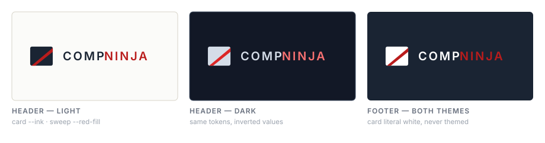
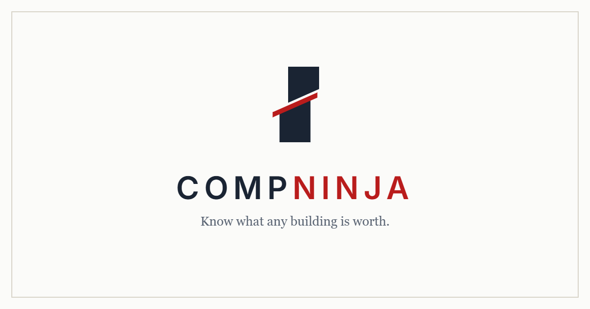

# CompNinja Design System

The brand in one place: fonts, colours, numbers, styles, logos.

**Who this is for.** Chuck, and anyone else who needs to change how the site
looks without reading the 1.3MB `index.html`. Everything visual on CompNinja
comes from a small set of values documented here. Change the value, and every
page that uses it changes with it.

**How the site is built, in one paragraph.** There is no build step, no design
tool, and no CMS. The site is plain HTML and CSS written directly into a few
files. Colours are the exception — they are named tokens (`--red`, `--ink`)
defined centrally, so changing one changes every page at once. Sizes, spacing
and fonts are mostly not tokenised: they are written into each stylesheet, so
changing one means finding each place it appears. (A few pages do carry their
own size scales — see §5 — but nothing shares them yet.)

**For the non-visual half of the brand** — name, legal entity, voice, and the
language rules that are promises rather than style choices — see
[BRAND.md](BRAND.md).

Read §1 before changing a colour. It is the shortest section and the only one
with a trap in it. §9 lists what this system does not cover yet.

*Checked against the code on 2026-10-30.*

---

## 1. The one rule

**Colours are named, never typed.** A page says `var(--red)`, not `#B91C1C`.
The names and their values live in `theme.js`.

This matters because the site has a **dark mode**. Every colour has two values —
one for light, one for dark — and the token is what picks between them. A raw
hex code typed into a page is the same colour on both, which is how you get
black text on a black background.

So: to change a colour, change the token. Do not hunt for hex codes in the page
files. If you find one, it is either a deliberate exception (documented in §7),
the app's class bridge (below), or a bug.

### ⚠ The app is the exception: its colours are class names

`index.html` (the app) is styled with Tailwind utility classes, and those
classes spell colours as their **light** hex value — `text-[#68707E]`,
`border-[#D8D4C9]`. About 870 of them. They are not tokens, so on their own
they would never change in dark mode.

What makes them work is the **dark mode bridge**, a block near the top of
`index.html`'s `<style>`. It re-points each colour class at its token in dark
mode, one rule per class:

```css
[data-theme="dark"] .bg-\[\#FBFBF9\] { background-color: var(--paper) }
```

So in the app, **adding a colour class nobody has used before means adding a
bridge rule for it.** Forget, and light mode looks perfect while dark mode
shows dark-on-dark text. `test/theme.test.js` ("every colour utility in
index.html has a dark rule") fails the build when that happens, so you will
find out — but that is why it fails.

Reuse a colour class that already exists wherever you can. Each light hex in
the token table in §4 is the class to use for that token.

### ⚠ Two things about changing a colour

**1. Every value is written twice.** `theme.js` is the source of truth, but
`index.html` is a static file the server never templates, so it carries a
hand-copied mirror of the whole table — the `:root{...}` block and the
`[data-theme="dark"]{...}` block at the top of its `<style>` (about line 145).
A colour change must be made in **both**:

- `theme.js` — the `THEME_TOKENS` table (`light` and `dark`)
- `index.html` — the `:root{...}` block *and* the `[data-theme="dark"]{...}`
  block

`test/theme.test.js` checks that every token's light and dark value appears
in `index.html` exactly as `theme.js` has it, and fails the build if not.

**2. The core colours are deliberately locked.** The test also pins exact
values — because five shipped pages were built on them, and a silent drift
restyles all five. Changing one of those on purpose means updating the
expected value in `test/theme.test.js` too.

That is not a hoop to jump through, it is the safety rail: it means nobody can
move the brand's core palette by accident. **Locked tokens:**

- **Light values:** `paper`, `wash`, `edge`, `line`, `hair`, `ink`, `ink-2`,
  `ink-3`, `ink-4`, `red`, `red-deep`, `green`.
- **Dark values:** every surface (`paper`, `card`, `wash`, `wash-2`, `slab`),
  every rule (`edge`, `line`, `hair`), the whole ink ramp, and `err-rule`.

Anything not listed (the red fills, the status and badge colours) can be
changed in the two files alone.

Get this wrong and the test suite fails — on your machine when you run
`npm test`, and on GitHub (CI runs it on every push; a red X means fix it
now). It does **not** stop the server from starting: `npm start` only checks
that `server.js` parses. The tests were taken out of `npm start` on
2026-08-20 because they were killing production deploys.

---

## 2. Logos

The mark is a **navy rounded rectangle crossed by a red diagonal band**. It is
drawn in code (SVG), not stored as an image file, so it stays sharp at any size
and can change colour with the theme.



All three appearances above are the same two shapes; only the fills differ.

| | Where | Name | Lives in | Notes |
|---|---|---|---|---|
| | Site header | `CN_LOGO` | `server.js` (search `const CN_LOGO`) | Themed — card is `--ink`, sweep is `--red-fill` |
| | Dark footer | `CN_LOGO_LIGHT` | `server.js`, just below it | Card is **always** white, never themed |
|  | Browser tab | `favicon.ico`, `favicon.svg`, `favicon.png` | repo root | |
|  | iOS home screen | `apple-touch-icon.png` | repo root | 180×180 |
|  | Link previews | `og-image.png` | repo root | 1200×630, shown when the site is shared |
|  | Installed app | `icon-192.png` | repo root | 192×192, PWA install |
|  | Installed app | `icon-512.png` | repo root | 512×512, PWA install |
|  | Android adaptive | `icon-maskable-512.png` | repo root | 512×512, safe-zone padded |

**The wordmark** is set beside the mark, not part of it: `Comp` in ink and
`Ninja` in red, uppercase, 15px, weight 600, letter-spacing `.14em`. In the
signed-in rail (§6) the wordmark hides and the mark stands alone at 30px.

**Two logos, on purpose.** The header mark inverts with the theme. The footer
mark sits on a navy slab that is dark in *both* themes, so it must stay white
always. They differ by exactly one fill colour and cannot be merged — whichever
one you merged into would break in the other context.

**Geometry** (both marks, 30×30 viewBox):
- Card: `rect` at 2,4 · 26×22 · corner radius 2
- Sweep: `polygon` 3.5,26 → 28,5.5 → 28,10 → 8,26

Changing the artwork means editing those two shapes in both places, plus
regenerating the eight image files above from the new shape. The three PWA
icons are easy to forget — they are pinned against `manifest.webmanifest` by
`test/manifest.test.js`, so a stale one survives every check the suite makes
and only shows up on somebody's installed copy.

---

## 3. Fonts

Two typefaces, with a clear division of labour.

| Role | Font | Used for |
|---|---|---|
| **Display** | Georgia (fallback: Times New Roman, serif) | Headings, and **every dollar figure** |
| **Interface** | Inter (fallback: system UI stack) | Body copy, labels, tables, buttons, navigation |
| **Code** | ui-monospace / SF Mono / Menlo / Consolas | Rare — admin pages only |

**The rule worth knowing:** serif means *this is the answer*. Headings and the
valuation figures are Georgia; everything that helps you read them is Inter. A
dollar amount set in Inter reads as interface chrome rather than the number the
whole page exists to deliver.

Inter is loaded from Google Fonts (`index.html`, about line 92) at weights
400, 500, 600, 700, 800. Georgia is not loaded at all — it ships with every OS.

**Weights in use:** 400 body · 500 serif headings and figures · 600 labels,
buttons, table headers, emphasis · 700/800 rare.

Figures use `font-variant-numeric: tabular-nums` so digits align in columns.
Keep that on anything showing money.

**Font tokens, partly.** The admin dashboards and the Comps/Pipeline page
(`vault-page.js`) define `--serif` for the Georgia stack. Everywhere else —
`MARKET_CSS`, `index.html`, the public pages — writes the stack out in full,
about 60 times. Changing the display font is still a find-and-replace.

---

## 4. Colours

All values below are the live tokens in `theme.js`. Light value first, dark
second. Use the **name**, never the hex — except in the app's Tailwind
classes, where the light hex *is* the name (§1).

### Surfaces

| Token | Light | Dark | Use |
|---|---|---|---|
| `--paper` | `#FBFBF9` | `#121826` | The page itself |
| `--card` | `#ffffff` | `#1A2433` | A card sitting on the page |
| `--wash` | `#F5F4EF` | `#243044` | Lifted panel, table headers |
| `--wash-2` | `#F5F4EF` | `#334155` | Hover, or a tile inside a card |
| `--slab` | `#1A2433` | `#243044` | Surfaces that are dark in *both* themes (the footer, the signed-in rail) |

`--wash` and `--wash-2` share a light value on purpose: in light mode a hover
*darkens*, in dark mode it *lightens*. One token cannot say both.

### Rules and borders

| Token | Light | Dark | Use |
|---|---|---|---|
| `--edge` | `#D8D4C9` | `#333E4F` | Primary border — cards, buttons, inputs |
| `--line` | `#E4E2DA` | `#2A3648` | Secondary border |
| `--hair` | `#F0EFE9` | `#222F40` | Hairline divider between rows |

Which of these draws the lines on a given page is not guessable — measure
before retuning one. `theme.js`'s header has the history of getting it wrong.

### Ink (text)

Seven steps, dark to light. `--ink-3` is the workhorse for muted text.

| Token | Light | Dark | Use |
|---|---|---|---|
| `--ink` | `#1A2433` | `#E4E9F0` | Headings, figures, emphasis |
| `--ink-body` | `#374253` | `#B6C1CF` | Body copy |
| `--ink-2` | `#4C5665` | `#A8B6C6` | Secondary copy |
| `--ink-mute` | `#5A6473` | `#96A3B4` | Navigation, captions |
| `--ink-3` | `#68707E` | `#8B98A8` | Labels, table headers, fine print — the faintest text a reader must be able to read |
| `--ink-faint` | `#9AA2AD` | `#5E6978` | **A whisper, not text.** Below the accessibility contrast floor in both themes on purpose. Placeholder-grade hints only — never anything a reader has to read |
| `--ink-4` | `#C7CBD2` | `#475569` | Outlines, disabled states |

⚠ **On `--slab` the ramp runs backwards.** The slab is dark in both themes,
so a token built to darken on light paper stays dark on the slab and
disappears. Text on the slab uses literal light colours instead (§7).

### Brand red

Four tokens, because a red **link** and a red **button** need opposite
treatment in dark mode. Text has to lighten to stay readable; a filled button
must not, because white text sits on it.

| Token | Light | Dark | Use |
|---|---|---|---|
| `--red` | `#B91C1C` | `#F87171` | Links, accents, red text |
| `--red-deep` | `#991B1B` | `#FCA5A5` | Link hover |
| `--red-fill` | `#B91C1C` | `#DC2626` | Button background, logo sweep |
| `--red-fill-hover` | `#991B1B` | `#B91C1C` | Button hover |

Never paint a background with `--red` (the text red) — in dark mode it turns
pale pink. A test fails the build if a stylesheet does.

The Tailwind config (`tailwind.config.js`) also carries the full red ramp
50–900 for utility classes. `500` is `#EF4444`, `600` `#DC2626`, `700`
`#B91C1C`.

### Status

Each status is a triad — text, background, rule — so a message block is one
consistent colour family.

| Token | Light | Dark | Use |
|---|---|---|---|
| `--green` | `#15803D` | `#34D399` | Positive figures |
| `--ok-text` / `--ok-bg` / `--ok-rule` | `#06603A` / `#E7F5EE` / `#BFE5D2` | `#6EE7B7` / `#0C2B21` / `#155E43` | Verified badge, success |
| `--warn-text` / `--warn-bg` / `--warn-rule` | `#8A6D1A` / `#FBF3DC` / `#EDDFB0` | `#FCD34D` / `#2A2410` / `#5B4A16` | Listing badge, caution |
| `--err-text` / `--err-bg` / `--err-rule` | `#7F1D1D` / `#FCF1EF` / `#F0C7C7` | `#F87171` / `#2A1517` / `#943F3F` | Errors |
| `--est-text` / `--est-bg` | `#9A3412` / `#F8E9DC` | `#FDBA74` / `#2A1C12` | Estimate badge (sienna) |
| `--bv-text` / `--bv-bg` | `#4C3A8C` / `#EDE9F8` | `#C4B5FD` / `#1C1730` | "Your comp" badge (purple) |

Estimate and "Your comp" keep their own identities rather than borrowing
warn/ok — otherwise Estimate collapses into Listing, and a member's private
comps look Verified.

The rules (`--*-rule`) are borders, kept quiet on purpose: all three sit at
about 2:1 (1.8–2.5:1) against their own background in dark, so no alert
shouts over its own message.

### Elevation

`--lift` is a shadow that is `none` in light mode and a soft inset highlight
plus drop shadow in dark. Cards apply `box-shadow: var(--lift)` — a no-op on
light paper, and the thing that separates a card from charcoal in dark. If
cards ever read as undefined in dark, reach for `--lift` before `--edge`.

---

## 5. Numbers

These are the values the main components use. Many more are in use around the
site (35 font sizes, 18 corner radii) — §9 has the count. When adding
something new, pick from these tables.

### Type scale

| Size | Font | Use |
|---|---|---|
| 9–10px | Inter | Photo credits, finest print |
| **10.5px** | Inter 600, uppercase, `.07–.12em` tracking | The micro-label — table headers, tile labels, badges. Also the rail's row labels (not uppercase) |
| 12–12.5px | Inter | Captions, footnotes |
| **13–13.5px** | Inter | Navigation, tables, small buttons |
| **14.5px** | Inter | Body copy |
| 15px | Inter 600 | Wordmark |
| 16px | Inter | Form inputs — **never smaller** (iOS Safari zooms below 16px and stays zoomed) |
| 17–19px | Georgia 500 | Card headings |
| 20–24px | Georgia 500 | Section headings, ledger figures |
| 22px | Georgia 500 | CTA headings |
| 25px | Georgia 500 | Tile figures |
| **26px / 32px** | Georgia 500 | **The valuation hero** — Low and High at 26px, Likely at 32px |
| 27–29px | Georgia 500 | Landing sub-headings, emphasised ledger figure |
| **28 → 34px** | Georgia 500, line-height 1.15 | Page H1 (28px, lifting to 34px at ≥640px) |
| 38px / 42px | Georgia 400, line-height 1.12–1.15 | Home page headlines (`home-page.js`) |

Uppercase micro-labels always carry letter-spacing. Serif headings carry
none (or a hair negative: `-.005em` on H1).

**Scales that exist but are not shared.** The admin dashboards (`/dev`, `/hq`,
analytics) and the Comps/Pipeline page (`vault-page.js`) each define a type
scale `--t1`…`--t6`, a spacing scale `--s1`…`--s9` and a radius `--r`. They
are page-local copies and they disagree:

| | Dashboards | Comps/Pipeline |
|---|---|---|
| `--t1` (largest) | 32px | 34px |
| `--t2` | 19px | 20px |
| `--t3`…`--t6` | 15 · 14 · 12.5 · 11px | 15 · 14 · 12.5 · 11px |
| `--s1`…`--s9` | 2 · 4 · 8 · 12 · 16 · 24 · 32 · 48 · 80px | same |
| `--r` | 4px | 6px |

The customer pages (`MARKET_CSS`, `index.html`, the public pages) do not use
them. The theme test lets these names through as page-local; they are not in
`theme.js`.

### Corner radius

| Value | Use |
|---|---|
| 3px | Badges |
| 4px | Buttons, chips, filter pills, and the app's inputs (Tailwind `rounded`) |
| **6px** | Cards, panels, tables, server-page inputs — the default |
| 8px | Dropdown menus |
| 10px | Rail rows |
| 999px | Full pills (the Comps section tabs) |
| 50% | Circles (avatars, dots) |

### Spacing and layout

- **Page width:** 1120px max on server-rendered pages (`.wrap`), 1024px in
  the app (Tailwind `max-w-5xl`); 16px side padding
- **Signed-in rail:** 84px wide, at 900px and up (§6)
- **Main content:** 32px top, 64px bottom
- **Card padding:** 22px (28px for a CTA block)
- **Tile padding:** 16px 18px
- **Table cells:** 10px; headers 9px 10px
- **Button padding:** 11px 26px (small: 7px 14px)
- **Gaps:** 8px tight · 12px grid · 18px header items
- **Card margin:** 18px between stacked cards

Common step: 4 · 6 · 8 · 10 · 12 · 16 · 18 · 22 · 26 · 28.

### Line height and measure

- Body: **1.6**
- Headings and figures: **1.15–1.2**
- Reading width caps: `52ch` CTA copy · `68–72ch` legal and footer prose ·
  `70ch` page subtitles

### Breakpoints

There is no single grid system — breakpoints were added where a specific
layout broke. Counted across every stylesheet:

| Width | Times used | What changes |
|---|---|---|
| **900px** | 22 | Signed-in pages get the left rail (min-width 900px); below it the wrapping top bar returns |
| **640px** | 19 | H1 lifts 28 → 34px at ≥640px, header nav gap widens, footer goes horizontal; below it, phone layouts |
| **700px** (max-width) | 5 | Ledger stacks vertically, market hero shortens 340 → 240px and its H1 drops to 24px |
| 560px (min-width) | 5 | App layout adjustments |
| 420 · 520 · 600 · 620 · 720 · 760 · 920 · 1000px | 1–3 each | One-off fixes |

The counts treat `899px`, `899.98px` and `901px` as 900px (and likewise for
640px and 560px): they are the same breakpoint written from the other side.

If you are adding one, reach for 640px, 700px or 900px before inventing a new
value.

---

## 6. Styles

The recurring components, and what they are made of. The server-page class
name comes first; the app (`index.html`) usually has its own copy with an
`rd-` prefix.

**Button** — `.btn`. Red fill (`--red-fill`), white text, weight 600, 14.5px,
11px 26px padding, 4px radius. Hover darkens to `--red-fill-hover`. White text
stays white on hover. `.btn.sm` is the header size: 7px 14px, 13px.
*On the slab* (the dark call-to-action bands on the home page and
`/brokers-firms`) the button is larger — 15px, about 13px 26px, 6px radius —
and its colours are literal (`#DC2626`, hover `#B91C1C`), see §7. Several
pages restyle `.btn` locally; §9 counts them.

**Card** — `.card`. White (`--card`) on a 1px `--edge` border, 6px radius,
22px padding, 18px vertical margin, `--lift` shadow. Heading is Georgia 500 at
19px, sentence case — never the uppercase micro-label, because these headings
are sentence-length.

**Ledger** — `.ledger` / `.lcell` (`.rd-ledger` / `.rd-lcell` in the app). The
headline-figures strip: equal cells divided by hairlines inside one bordered
box. The emphasised cell (`.mid`) gets `--wash-2` behind it, a red label, and a
larger figure. This is the house pattern for presenting a valuation — used on
the report hero, market pages, and the Comps page.

| Where | Normal cell | Emphasised cell |
|---|---|---|
| Report hero (Low / **Likely** / High) | 26px | 32px |
| Market page | 24px | 29px |
| Auxiliary strip (`.ledger.aux`) | 20px | — |

Below 700px it stacks vertically and the cell dividers move from right edges to
bottom edges.

**Badge** — `.badge` (`.rd-badge` in the app). 10.5px, weight 600, 3px
radius, 1.5px 7px padding. One variant per source tier:

| Class | Label | Colours |
|---|---|---|
| `.v` | Verified | `--ok-text` on `--ok-bg` (green) |
| `.p` | Public record | blue-grey, **literal hex** — no token yet (§9) |
| `.li` | Listing | `--warn-text` on `--warn-bg` (amber) |
| `.n` | News | `--ink-mute` on `--wash` |
| `.e` | Estimate | `--est-text` on `--est-bg` (sienna) |
| `.u` | Added by you | `--ink-mute` on `--wash`, outlined in `--edge` |
| `.bv` | Your comp | `--bv-text` on `--bv-bg` (purple) |

The server pages carry only `.v` and `.li`. `.bv` is an *ownership*
statement, never provenance: it must never be `.v`, because green Verified is
a public claim the server awards when a named broker vouches, and a private
row has not earned it.

**Table** — 13.5px, tabular figures, 640px minimum width inside a horizontally
scrolling `.scroll` wrapper. Headers are the 10.5px uppercase micro-label on
`--wash`. Rows separate with `--hair`.
The statement variant (`table.stmt`) drops the header fill for a 2px ink rule
and closes with a double rule under the total — the accounting look.

**Input** — 16px text, 1px `--edge` border. Focus turns the border red and
adds a 1px red ring. Radius and padding differ by surface: server pages use
6px and about 9–10px × 12px; the app uses Tailwind's `rounded` (4px). **16px
is a hard floor** — see §9 for the fields that break it. The app's search
card is the exception in shape: there the *cell* (`.rd-cell`) draws the box
and focus ring, and the field inside (`.rd-in`) is borderless and
transparent.

**Tile** — `.tile`. Micro-label above a 25px Georgia figure above a 12.5px
note, on `--card` with a 1px `--line` border, 6px radius, 16px 18px padding.
The three-part unit that most numbers on the site are presented in.

**Rail** — `RAIL_CSS` in `server.js`, with twin rules in `index.html`. At
900px and up, every signed-in page gets an 84px strip down the left on
`--slab`: the mark at 30px on top, then each place as a 22px icon over a
10.5px word. Rows are white at 68% opacity with a 10px radius; hover adds an
8% white wash, and the current page gets 13% and weight 600. Groups are
separated by a 1px line at 14% white. The red "Run a report" button is hidden
there. Below 900px the same markup is the ordinary wrapping top bar — there is
no drawer. Because it sits on the slab, its colours are literal white (§7).

**Section tabs** — `.cs-tabs` in `MARKET_CSS`, over `/comps` and `/bulk`. A
segmented pill: 1px `--line` border, 999px radius, 13.5px, `--ink-mute`
links; the current tab is `--ink` with `--paper` text, weight 600. It is a pill
rather than underlined tabs because `/comps` has a row of underlined tabs
under its title, and two rows of the same tab style read as one. Other pages
have their own tab styles (§9).

---

## 7. Where things live

| What | File |
|---|---|
| **Colours — source of truth** | `theme.js` |
| **Colours — mirror copy (must match)** | `index.html`, the two token blocks at the top of its `<style>` (about line 145) |
| **Colours — the app's dark mode bridge** | `index.html`, the "Dark mode bridge" block right below them |
| Server-rendered page styles | `MARKET_CSS` in `server.js` |
| Signed-in rail | `RAIL_CSS` in `server.js` (twin rules in `index.html`) |
| Header | `marketBar` in `server.js` |
| Footer | `MARKET_FOOTER`, `FOOTER_LINKS_CSS`, `FOOTER_DARK_CSS` in `server.js` |
| Home (landing) page | `HOME_CSS` in `home-page.js` |
| Brokers & firms page | `BF_CSS` in `brokers-firms-page.js` |
| FAQ / Pricing pages | `FAQ_CSS` in `faq-page.js` / `PRICING_CSS` in `pricing-page.js` |
| App styles | `<style>` block in `index.html` (starts about line 130) |
| Comps and Pipeline pages | `vault-page.js` |
| Hub page | `hub-page.js` |
| Logos | `CN_LOGO` / `CN_LOGO_LIGHT` in `server.js` |
| Tailwind red ramp | `tailwind.config.js` |
| Generated Tailwind CSS | `tailwind.css` — **generated, never hand-edit** |

**Two headers.** `index.html` draws its own header; `marketBar` in `server.js`
is the header for every server-rendered page. A change to one must be made to
both, or the header shifts as you move between pages —
`test/nav-parity.test.js` checks that they agree. The footer is
`MARKET_FOOTER` on every server-rendered page.

**Two deliberate exceptions to the no-hex rule.** Both are places where a
colour must *not* follow the theme:
1. **Anything on the slab.** `--slab` is dark in both themes, so the ink ramp
   runs backwards on it. The footer logo and wordmark, the footer's text
   (`FOOTER_DARK_CSS`), the signed-in rail, and the dark call-to-action bands
   on the home page, `/brokers-firms` and `/pricing` write their colours
   literally: white (or white at an opacity), and `theme.js`'s own dark values
   — `#B6C1CF` for text, `#F87171` for red accents, `#DC2626` / `#B91C1C` for
   buttons. The theme test's allowlist names these.
2. **Photographs and their overlays** — market hero images, Street View, aerial
   thumbnails. A picture of a place does not have a dark mode; the gradient and
   caption over it stay literal dark/white so the title reads on any photo.

---

## 8. Changing something

**A colour** — edit it in `theme.js` **and** in `index.html`'s two token blocks,
light and dark in both. If it is one of the locked core tokens, update
`test/theme.test.js` as well. In the app, a colour class nobody has used before
also needs a bridge rule. See the warnings in §1 — this is the one change with
a real trap in it.

**A number** (size, spacing, radius) — find it in the relevant stylesheet from
§7. If it appears in more than one file, change all of them. Pick from the
tables in §5 rather than adding a new value.

**A font** — the family is written into each stylesheet's `body` rule and into
every Georgia heading rule (about 60 places; a few pages use `--serif`). This
is still a find-and-replace across files.

**The logo** — both SVGs in `server.js`, plus regenerating the eight image
files in §2.

### Before you commit

Run the colour test. It takes under a second and needs nothing running:

```bash
node --test test/theme.test.js
```

It checks that every token has a valid light and dark value, that
`index.html`'s copy matches `theme.js`, that every app colour class has a dark
bridge rule, and that the stylesheets carry no stray hex codes outside the
allowlist. It will catch a typo'd colour immediately. The full suite
(`npm test`) runs on GitHub on every push.

**If you touched `index.html` and added a new Tailwind utility class**, the
vendored CSS must be regenerated or the class silently does nothing. In a
Claude Code session a hook does this automatically; outside one, run:

```bash
npx --yes tailwindcss@3.4.17 -c tailwind.config.js -i tailwind.input.css -o tailwind.css --minify
```

Commit the updated `tailwind.css` alongside the HTML change. Classes already
used anywhere in the file are covered — only genuinely new ones need this.

**Seeing your change:** editing `index.html`? It is read from disk on every
request, so just refresh. Editing a stylesheet inside `server.js` or one of the
`*-page.js` files? Those are loaded once at startup, so restart the server:

```bash
npm start
```

### Check both themes

Every visual change needs looking at in light **and** dark. The site follows
the operating system setting; switch your OS appearance to see the other one.
This is the single most common way a change looks finished and is not.

The screenshot tool takes before-and-after pictures of a page, in either theme
(PNGs land in `screenshots/`):

```bash
node scripts/shot.js /markets --before
```

```bash
node scripts/shot.js /markets --before --dark
```

---

## 9. What the system does not cover yet

Measured across every stylesheet on 2026-10-30. These are the known gaps, in
rough order of how much trouble they cause. None of them is a reason to add a
new one-off value — they are the reason to stop.

1. **The app's colours are hex classes, held up by a bridge.** About 870
   colour classes in `index.html` spell a light hex value (31 distinct), and
   dark mode works only through the bridge in §1. Eleven of those 31 match no
   token at all (`#B8C0CC`, the footer's text, alone is used 16 times). The fix
   is to register the tokens in `tailwind.config.js` so the app can write
   `text-ink-3` and the bridge can go.
2. **Sizes are not a system.** 35 different font sizes are in use, 18 corner
   radii, and 12 breakpoint widths. The type and spacing scales in §5 exist
   only on the dashboards and the Comps/Pipeline page, and the two copies
   disagree. The fix is one scale in `theme.js` that every page shares.
3. **Components are copied, not shared.** `.btn` is restyled in 8 files (19
   rules), in at least three sizes. There are five separate tab styles:
   `.cs-tabs` (Comps section), `.vt-tab` (`vault-page.js`), `.pt-tab`
   (`permits-page.js`), `.rk-tab` (`market-rank-page.js`) and `.hm-tabs`
   (Home, `index.html`). Menus, popups, toasts and empty states have no
   documented pattern at all.
4. **The Public record badge has no token.** `.rd-badge.p` is literal
   `#46536A` on `#EAEEF4`, with a separate hand-written dark rule. It needs a
   `--pr-text` / `--pr-bg` pair like Estimate and Your comp have.
5. **Half the app's form fields are below the 16px floor.** Measured in a
   browser at phone width (390px), 42 of the 84 text fields and dropdowns in
   `index.html` render at 14px (Tailwind's `text-sm`), so iOS Safari zooms in
   when one is tapped. They include Home's find box and add-a-building form,
   the firm settings, the report form's property details (custom lookback,
   clear height, dock doors, market note, target price, NOI, cap rate), the
   add-a-comp form, and the DCF, operating-expense, debt and development
   calculators. The main address search is fine.
6. **Two public pages are not checked for stray hex.** The theme test scans
   `MARKET_CSS`, the rail, the account nav, `/faq` and `/pricing`, but not the
   home page (`home-page.js`) or `/brokers-firms` (`brokers-firms-page.js`).
