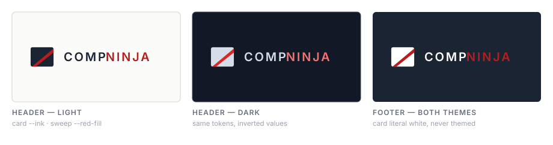
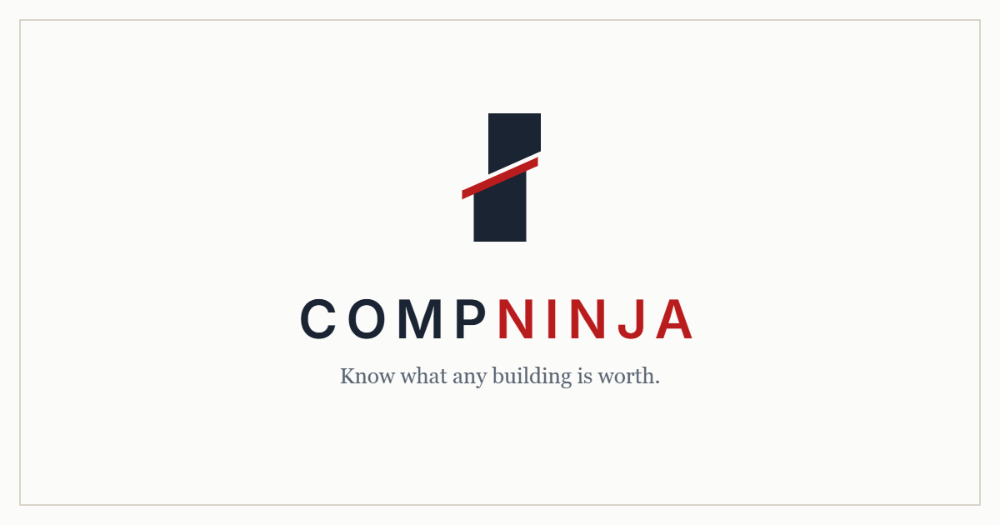

# CompNinja Design System

The brand in one place: fonts, colours, numbers, styles, logos.

**Who this is for.** Chuck, and anyone else who needs to change how the site
looks without reading the 1.3MB `index.html`. Everything visual on CompNinja
comes from a small set of values documented here. Change the value, and every
page that uses it changes with it.

**How the site is built, in one paragraph.** There is no build step, no design
tool, and no CMS. The site is plain HTML and CSS written directly into a few
files. Colours, fonts, text sizes and corner radii are the exception — they are
named tokens (`--red`, `--ink`, `--serif`, `--text-body`, `--r-md`) defined
centrally in `theme.js`, so changing one changes every page at once. Spacing
mostly is not: it is written into each stylesheet, so changing it means
finding each place it appears (§5).

**For the non-visual half of the brand** — name, legal entity, voice, and the
language rules that are promises rather than style choices — see
[BRAND.md](BRAND.md).

Read §1 before changing a colour. It is the shortest section and the only one
with a trap in it. §9 lists what this system does not cover yet.

*Checked against the code on 2026-10-30.*

---

## 1. The one rule

**Colours are named, never typed.** A page says `var(--red)`, not `#B91C1C`.
The names and their values live in `theme.js`.

This matters because the site has a **dark mode**. Every colour has two values —
one for light, one for dark — and the token is what picks between them. A raw
hex code typed into a page is the same colour on both, which is how you get
black text on a black background.

So: to change a colour, change the token. Do not hunt for hex codes in the page
files. If you find one, it is either a deliberate exception (documented in §7),
one of the app's leftover hex classes (below), or a bug.

### In the app, a colour is a class named after its token

`index.html` (the app) is styled with Tailwind utility classes. Every token
in §4 is also a colour class there, named after the token:

| You want | Write |
|---|---|
| Muted label text (`--ink-3`) | `text-ink-3` |
| The page background (`--paper`) | `bg-paper` |
| A card border (`--edge`) | `border-edge` |
| A hover that lifts (`--wash-2`) | `hover:bg-wash-2` |
| A red focus ring (`--red`) | `focus:ring-red` |
| Success text (`--ok-text`) | `text-ok-text` |

Each class is the token itself — `text-ink-3` is `color: var(--ink-3)` — so
it follows dark mode with nothing else to do. `tailwind.config.js` builds the
list from `theme.js`, so a new token gets its class on the next Tailwind
regenerate (§8).

**Never write a token's hex as a class** (`text-[#68707E]`). It looks the
same in light mode and stays light in dark mode. Until 2026-10-30 the whole app
was written that way, about 870 classes, and kept working only through a
hand-written "dark mode bridge" that re-pointed each one in dark mode.

**What is still hex, and why.** A short bridge remains near the top of
`index.html`'s `<style>`, for about 30 colour classes that are *not* a token in
light mode: colours the palette never named (the footer's `#B8C0CC`, a
`#F4FAF6` tint) and Tailwind's own reds and greens (`bg-brand-600` is
`#DC2626`, brighter than `--red-fill`). Switching any of them to a token class
would change how light mode looks, so each is a design decision, not a cleanup
— see §9. A new hex class of this kind needs a bridge rule too, or it shows
dark-on-dark text in dark mode.

Three tests in `test/theme.test.js` hold this together: every hex colour class
in the app has a bridge rule; no bridge rule is for a hex that is already a
token (that one should be the token's class); and every token class the app
uses is in the generated `tailwind.css`.

### ⚠ Two things about changing a colour

**1. Every value is written twice.** `theme.js` is the source of truth, but
`index.html` is a static file the server never templates, so it carries a
hand-copied mirror of the whole table — the `:root{...}` block and the
`[data-theme="dark"]{...}` block at the top of its `<style>` (about line 145).
A colour change must be made in **both**:

- `theme.js` — the `THEME_TOKENS` table (`light` and `dark`)
- `index.html` — the `:root{...}` block *and* the `[data-theme="dark"]{...}`
  block

`test/theme.test.js` checks that every token's light and dark value appears
in `index.html` exactly as `theme.js` has it, and fails the build if not.

**2. The core colours are deliberately locked.** The test also pins exact
values — because five shipped pages were built on them, and a silent drift
restyles all five. Changing one of those on purpose means updating the
expected value in `test/theme.test.js` too.

That is not a hoop to jump through, it is the safety rail: it means nobody can
move the brand's core palette by accident. **Locked tokens:**

- **Light values:** `paper`, `wash`, `edge`, `line`, `hair`, `ink`, `ink-2`,
  `ink-3`, `ink-4`, `red`, `red-deep`, `green`.
- **Dark values:** every surface (`paper`, `card`, `wash`, `wash-2`, `slab`),
  every rule (`edge`, `line`, `hair`), the whole ink ramp, and `err-rule`.

Anything not listed (the red fills, the status and badge colours) can be
changed in the two files alone.

Get this wrong and the test suite fails — on your machine when you run
`npm test`, and on GitHub (CI runs it on every push; a red X means fix it
now). It does **not** stop the server from starting: `npm start` only checks
that `server.js` parses. The tests were taken out of `npm start` on
2026-08-20 because they were killing production deploys.

---

## 2. Logos

The mark is a **navy rounded rectangle crossed by a red diagonal band**. It is
drawn in code (SVG), not stored as an image file, so it stays sharp at any size
and can change colour with the theme.



All three appearances above are the same two shapes; only the fills differ.

| | Where | Name | Lives in | Notes |
|---|---|---|---|---|
| | Site header | `CN_LOGO` | `server.js` (search `const CN_LOGO`) | Themed — card is `--ink`, sweep is `--red-fill` |
| | Dark footer | `CN_LOGO_LIGHT` | `server.js`, just below it | Card is **always** white, never themed |
|  | Browser tab | `favicon.ico`, `favicon.svg`, `favicon.png` | repo root | |
|  | iOS home screen | `apple-touch-icon.png` | repo root | 180×180 |
|  | Link previews | `og-image.png` | repo root | 1200×630, shown when the site is shared |
|  | Installed app | `icon-192.png` | repo root | 192×192, PWA install |
|  | Installed app | `icon-512.png` | repo root | 512×512, PWA install |
|  | Android adaptive | `icon-maskable-512.png` | repo root | 512×512, safe-zone padded |

**The wordmark** is set beside the mark, not part of it: `Comp` in ink and
`Ninja` in red, uppercase, 15px, weight 600, letter-spacing `.14em`. In the
signed-in rail (§6) the wordmark hides and the mark stands alone at 30px.

**Two logos, on purpose.** The header mark inverts with the theme. The footer
mark sits on a navy slab that is dark in *both* themes, so it must stay white
always. They differ by exactly one fill colour and cannot be merged — whichever
one you merged into would break in the other context.

**Geometry** (both marks, 30×30 viewBox):
- Card: `rect` at 2,4 · 26×22 · corner radius 2
- Sweep: `polygon` 3.5,26 → 28,5.5 → 28,10 → 8,26

Changing the artwork means editing those two shapes in both places, plus
regenerating the eight image files above from the new shape. The three PWA
icons are easy to forget — they are pinned against `manifest.webmanifest` by
`test/manifest.test.js`, so a stale one survives every check the suite makes
and only shows up on somebody's installed copy.

---

## 3. Fonts

Two typefaces, with a clear division of labour.

| Role | Font | Used for |
|---|---|---|
| **Display** | Georgia (fallback: Times New Roman, serif) | Headings, and **every dollar figure** |
| **Interface** | Inter (fallback: system UI stack) | Body copy, labels, tables, buttons, navigation |
| **Code** | ui-monospace / SF Mono / Menlo / Consolas | Rare — admin pages only |

**The rule worth knowing:** serif means *this is the answer*. Headings and the
valuation figures are Georgia; everything that helps you read them is Inter. A
dollar amount set in Inter reads as interface chrome rather than the number the
whole page exists to deliver.

Inter is loaded from Google Fonts (`index.html`, about line 92) at weights
400, 500, 600, 700, 800. Georgia is not loaded at all — it ships with every OS.

**Weights in use:** 400 body · 500 serif headings and figures · 600 labels,
buttons, table headers, emphasis · 700/800 rare.

Figures use `font-variant-numeric: tabular-nums` so digits align in columns.
Keep that on anything showing money.

**Font tokens.** `theme.js` names the three stacks: `--serif` (Georgia),
`--sans` (Inter) and `--mono`. Every stylesheet writes `font-family:
var(--serif)`, so changing the display font is one edit in `theme.js` (and its
copy in `index.html`). About ten Inter and monospace stacks whose fallback
list differs from the token's are still written out, `index.html`'s `body`
rule among them: switching one to the token would change which font a browser
falls back to.

---

## 4. Colours

All values below are the live tokens in `theme.js`. Light value first, dark
second. Use the **name**, never the hex — `var(--ink-3)` in a stylesheet,
`text-ink-3` in the app's Tailwind classes (§1).

### Surfaces

| Token | Light | Dark | Use |
|---|---|---|---|
| `--paper` | `#FBFBF9` | `#121826` | The page itself |
| `--card` | `#ffffff` | `#1A2433` | A card sitting on the page |
| `--wash` | `#F5F4EF` | `#243044` | Lifted panel, table headers |
| `--wash-2` | `#F5F4EF` | `#334155` | Hover, or a tile inside a card |
| `--slab` | `#1A2433` | `#243044` | Surfaces that are dark in *both* themes (the footer, the signed-in rail) |

`--wash` and `--wash-2` share a light value on purpose: in light mode a hover
*darkens*, in dark mode it *lightens*. One token cannot say both.

### Rules and borders

| Token | Light | Dark | Use |
|---|---|---|---|
| `--edge` | `#D8D4C9` | `#333E4F` | Primary border — cards, buttons, inputs |
| `--line` | `#E4E2DA` | `#2A3648` | Secondary border |
| `--hair` | `#F0EFE9` | `#222F40` | Hairline divider between rows |

Which of these draws the lines on a given page is not guessable — measure
before retuning one. `theme.js`'s header has the history of getting it wrong.

### Ink (text)

Seven steps, dark to light. `--ink-3` is the workhorse for muted text.

| Token | Light | Dark | Use |
|---|---|---|---|
| `--ink` | `#1A2433` | `#E4E9F0` | Headings, figures, emphasis |
| `--ink-body` | `#374253` | `#B6C1CF` | Body copy |
| `--ink-2` | `#4C5665` | `#A8B6C6` | Secondary copy |
| `--ink-mute` | `#5A6473` | `#96A3B4` | Navigation, captions |
| `--ink-3` | `#68707E` | `#8B98A8` | Labels, table headers, fine print — the faintest text a reader must be able to read |
| `--ink-faint` | `#9AA2AD` | `#5E6978` | **A whisper, not text.** Below the accessibility contrast floor in both themes on purpose. Placeholder-grade hints only — never anything a reader has to read |
| `--ink-4` | `#C7CBD2` | `#475569` | Outlines, disabled states |

⚠ **On `--slab` the ramp runs backwards.** The slab is dark in both themes,
so a token built to darken on light paper stays dark on the slab and
disappears. Text on the slab uses literal light colours instead (§7).

### Brand red

Four tokens, because a red **link** and a red **button** need opposite
treatment in dark mode. Text has to lighten to stay readable; a filled button
must not, because white text sits on it.

| Token | Light | Dark | Use |
|---|---|---|---|
| `--red` | `#B91C1C` | `#F87171` | Links, accents, red text |
| `--red-deep` | `#991B1B` | `#FCA5A5` | Link hover |
| `--red-fill` | `#B91C1C` | `#DC2626` | Button background, logo sweep |
| `--red-fill-hover` | `#991B1B` | `#B91C1C` | Button hover |

Never paint a background with `--red` (the text red) — in dark mode it turns
pale pink. A test fails the build if a stylesheet does.

The Tailwind config (`tailwind.config.js`) also carries the full red ramp
50–900 for utility classes. `500` is `#EF4444`, `600` `#DC2626`, `700`
`#B91C1C`.

### Status

Each status is a triad — text, background, rule — so a message block is one
consistent colour family.

| Token | Light | Dark | Use |
|---|---|---|---|
| `--green` | `#15803D` | `#34D399` | Positive figures |
| `--ok-text` / `--ok-bg` / `--ok-rule` | `#06603A` / `#E7F5EE` / `#BFE5D2` | `#6EE7B7` / `#0C2B21` / `#155E43` | Verified badge, success |
| `--warn-text` / `--warn-bg` / `--warn-rule` | `#8A6D1A` / `#FBF3DC` / `#EDDFB0` | `#FCD34D` / `#2A2410` / `#5B4A16` | Listing badge, caution |
| `--err-text` / `--err-bg` / `--err-rule` | `#7F1D1D` / `#FCF1EF` / `#F0C7C7` | `#F87171` / `#2A1517` / `#943F3F` | Errors |
| `--est-text` / `--est-bg` | `#9A3412` / `#F8E9DC` | `#FDBA74` / `#2A1C12` | Estimate badge (sienna) |
| `--bv-text` / `--bv-bg` | `#4C3A8C` / `#EDE9F8` | `#C4B5FD` / `#1C1730` | "Your comp" badge (purple) |

Estimate and "Your comp" keep their own identities rather than borrowing
warn/ok — otherwise Estimate collapses into Listing, and a member's private
comps look Verified.

The rules (`--*-rule`) are borders, kept quiet on purpose: all three sit at
about 2:1 (1.8–2.5:1) against their own background in dark, so no alert
shouts over its own message.

### Elevation

`--lift` is a shadow that is `none` in light mode and a soft inset highlight
plus drop shadow in dark. Cards apply `box-shadow: var(--lift)` — a no-op on
light paper, and the thing that separates a card from charcoal in dark. If
cards ever read as undefined in dark, reach for `--lift` before `--edge`.

---

## 5. Numbers

Since 2026-11-01 the sizes are named tokens too: `SCALE_TOKENS` in `theme.js`,
which every page receives (server pages through `rootCss()`, the admin pages
through `scaleCss()`, and `index.html` through its hand-copy, which a test
pins). A stylesheet writes `font-size: var(--text-ui)` and
`border-radius: var(--r-md)`, never `13.5px` or `6px`.

The values are the ones the site already used, so naming them moved nothing.
That is why the text scale still has neighbours half a pixel apart (12/12.5,
13/13.5, 14/14.5): folding them is now a one-line change in `theme.js` that
moves every page at once, and a design call to make on purpose (§9).

**A test holds the line**: `test/theme.test.js` ("no stylesheet gains a text
size or radius that is off the scale") fails the build on a NEW size that is
not a token. The sizes that were in use but are off the scale are listed there
and may only be removed, never added to.

### Type scale

| Token | Size | Font | Use |
|---|---|---|---|
| `--text-micro` | **10.5px** | Inter 600, uppercase, `.07–.12em` tracking | The micro-label — table headers, tile labels, badges. Also the rail's row labels (not uppercase) |
| `--text-tiny` | 11px | Inter | Fine print |
| `--text-label` | 12px | Inter | Labels |
| `--text-note` | 12.5px | Inter | Captions, footnotes, the note under a figure |
| `--text-small` | 13px | Inter | Small buttons, the footer |
| `--text-ui` | **13.5px** | Inter | Navigation, tables |
| `--text-compact` | 14px | Inter | Dense body copy |
| `--text-body` | **14.5px** | Inter | Body copy |
| `--text-lead` | 15px | Inter 600 | Wordmark, large buttons |
| `--text-input` | 16px | Inter | Form inputs — **never smaller** (iOS Safari zooms below 16px and stays zoomed) |
| `--text-title` | 19px | Georgia 500 | Card headings |
| `--text-subhead` | 20px | Georgia 500 | Sub-headings |
| `--text-heading` | 24px | Georgia 500 | Section headings, ledger figures |
| `--text-figure` | **26px** | Georgia 500 | **The valuation hero's** Low and High |
| `--text-h1` | **28px** | Georgia 500, line-height 1.15 | Page H1 on a phone |
| `--text-hero` | **32px** | Georgia 500 | **The valuation hero's** Likely; the admin pages' titles |
| `--text-h1-lg` | **34px** | Georgia 500, line-height 1.15 | Page H1 from 640px up |
| `--text-display` | 38px | Georgia 400, line-height 1.15 | Home page headlines (`home-page.js`) |
| `--text-display-lg` | 42px | Georgia 400, line-height 1.12 | Home page headlines |

Off the scale, still written as literals: 9, 9.5, 10, 11.5, 15.5, 16.5, 17, 18,
21, 22, 23, 25, 29, 30 and 36px (about 110 uses in all; 11.5px alone is 30).

Uppercase micro-labels always carry letter-spacing. Serif headings carry
none (or a hair negative: `-.005em` on H1).

### Corner radius

| Token | Value | Use |
|---|---|---|
| `--r-xs` | 3px | Badges |
| `--r-sm` | 4px | Buttons, chips, filter pills, and the app's inputs (Tailwind `rounded`) |
| `--r-md` | **6px** | Cards, panels, tables, server-page inputs — the default |
| `--r-lg` | 8px | Dropdown menus |
| `--r-xl` | 10px | Rail rows |
| `--r-2xl` | 12px | Home's rows and start screen, the Sites board's columns |
| `--r-pill` | 999px | Full pills (the Comps section tabs) |
| — | 50% | Circles (avatars, dots) |

Off the scale, still literal: 2, 5, 9, 11, 14, 16, 18 and 20px, and two other
ways of writing a pill (99px, 9999px).

### Spacing and layout

- **Page width:** 1120px max on server-rendered pages (`.wrap`), 1024px in
  the app (Tailwind `max-w-5xl`); 16px side padding
- **Signed-in rail:** 84px wide, at 900px and up (§6)
- **Main content:** 32px top, 64px bottom
- **Card padding:** 22px (28px for a CTA block)
- **Tile padding:** 16px 18px
- **Table cells:** 10px; headers 9px 10px
- **Button padding:** 11px 26px (small: 7px 14px)
- **Gaps:** 8px tight · 12px grid · 18px header items
- **Card margin:** 18px between stacked cards

**The spacing scale** is `--s1` … `--s9`: 2 · 4 · 8 · 12 · 16 · 24 · 32 · 48 ·
80px. The admin pages and the Comps/Pipeline page are built on it; the
customer pages mostly are not. Their padding and margins were measured at 42
different values, and the most common (10, 6, 14, 18, 20px) are not on the
scale, so moving them onto it would visibly change spacing. New work should use
the scale; the rest is a design pass, not a rename.

Common steps in the customer pages today: 4 · 6 · 8 · 10 · 12 · 16 · 18 · 22 ·
26 · 28.

### Line height and measure

- Body: **1.6**
- Headings and figures: **1.15–1.2**
- Reading width caps: `52ch` CTA copy · `68–72ch` legal and footer prose ·
  `70ch` page subtitles

### Breakpoints

There is no single grid system — breakpoints were added where a specific
layout broke. Counted across every stylesheet:

| Width | Times used | What changes |
|---|---|---|
| **900px** | 22 | Signed-in pages get the left rail (min-width 900px); below it the wrapping top bar returns |
| **640px** | 19 | H1 lifts 28 → 34px at ≥640px, header nav gap widens, footer goes horizontal; below it, phone layouts |
| **700px** (max-width) | 5 | Ledger stacks vertically, market hero shortens 340 → 240px and its H1 drops to 24px |
| 560px (min-width) | 5 | App layout adjustments |
| 420 · 520 · 600 · 620 · 720 · 760 · 920 · 1000px | 1–3 each | One-off fixes |

The counts treat `899px`, `899.98px` and `901px` as 900px (and likewise for
640px and 560px): they are the same breakpoint written from the other side.

If you are adding one, reach for 640px, 700px or 900px before inventing a new
value.

---

## 6. Styles

The recurring components, and what they are made of. The server-page class
name comes first; the app (`index.html`) usually has its own copy with an
`rd-` prefix.

**The button and the tabs are defined once, in `components.js`**
(2026-11-10). That file holds a small table for each: what the component IS
(the canon), and the page families that were written before it existed, each
listing only where it still differs. The stylesheet is generated from the
table and reaches every page: `server.js` puts it inside `MARKET_CSS` for the
server-rendered pages and into `index.html` at its `COMPONENT_CSS` marker for
the app. No page writes its own button or tab rules any more (a test fails
the build if one does).

**Button** — two sizes and two looks.

| | Padding | Text | Corner | Use |
|---|---|---|---|---|
| **Action** (`.btn`) | 11px 26px | 14.5px, 600 | 4px | A page's main call to action |
| **Compact** (`.btn.sm`, and every page family) | 7px 12px | 13px, 600 | 6px | A control inside a working page |

| Look | Class | Made of |
|---|---|---|
| **Primary** | `.btn` | `--red-fill`, white text; hover `--red-fill-hover`. White stays white on hover |
| **Secondary** | `.btn.ghost` | `--card`, `--ink` text, 1px `--edge` border; hover turns the border `--ink-3` |

A compact button carries a 1px border in both looks, so a red one and an
outlined one side by side are the same size. Disabled is 60% opacity.

For **new work, use `.btn`, `.btn.sm` and `.btn.ghost`** and nothing else.
The page families (`.hm-btn` on Home and Sites, `.mc-btn` on the member card,
`.pw-btn` on Permits, `.msg-btn` in Messages, `.bd-btn` on The Board,
`.bs-btn` on the building sheet) are the same button under older names; each
still differs from the canon in a few small ways, listed in `components.js`
as its `differs` and counted in §9.

*On the slab* (the dark call-to-action bands on the home page and
`/brokers-firms`) the action button is larger — 15px, about 13px 26px, 6px
radius — and its colours are literal (`#DC2626`, hover `#B91C1C`), see §7.
Nine page rules restyle `.btn` for one spot like that; a test lists them and
refuses a tenth. The Comps and Pipeline pages restate the button whole at
their own size (9px 16px, 13.5px, 6px corners), on purpose: `vault-page.js`
keeps a complete design system of its own.

**Card** — `.card`. White (`--card`) on a 1px `--edge` border, 6px radius,
22px padding, 18px vertical margin, `--lift` shadow. Heading is Georgia 500 at
19px, sentence case — never the uppercase micro-label, because these headings
are sentence-length.

**Ledger** — `.ledger` / `.lcell` (`.rd-ledger` / `.rd-lcell` in the app). The
headline-figures strip: equal cells divided by hairlines inside one bordered
box. The emphasised cell (`.mid`) gets `--wash-2` behind it, a red label, and a
larger figure. This is the house pattern for presenting a valuation — used on
the report hero, market pages, and the Comps page.

| Where | Normal cell | Emphasised cell |
|---|---|---|
| Report hero (Low / **Likely** / High) | 26px | 32px |
| Market page | 24px | 29px |
| Auxiliary strip (`.ledger.aux`) | 20px | — |

Below 700px it stacks vertically and the cell dividers move from right edges to
bottom edges.

**Badge** — `.badge` (`.rd-badge` in the app). 10.5px, weight 600, 3px
radius, 1.5px 7px padding. One variant per source tier:

| Class | Label | Colours |
|---|---|---|
| `.v` | Verified | `--ok-text` on `--ok-bg` (green) |
| `.p` | Public record | blue-grey, **literal hex** — no token yet (§9) |
| `.li` | Listing | `--warn-text` on `--warn-bg` (amber) |
| `.n` | News | `--ink-mute` on `--wash` |
| `.e` | Estimate | `--est-text` on `--est-bg` (sienna) |
| `.u` | Added by you | `--ink-mute` on `--wash`, outlined in `--edge` |
| `.bv` | Your comp | `--bv-text` on `--bv-bg` (purple) |

The server pages carry only `.v` and `.li`. `.bv` is an *ownership*
statement, never provenance: it must never be `.v`, because green Verified is
a public claim the server awards when a named broker vouches, and a private
row has not earned it.

**Table** — 13.5px, tabular figures, 640px minimum width inside a horizontally
scrolling `.scroll` wrapper. Headers are the 10.5px uppercase micro-label on
`--wash`. Rows separate with `--hair`.
The statement variant (`table.stmt`) drops the header fill for a 2px ink rule
and closes with a double rule under the total — the accounting look.

**Input** — 16px text, 1px `--edge` border. Focus turns the border red and
adds a 1px red ring. Radius and padding differ by surface: server pages use
6px and about 9–10px × 12px; the app uses Tailwind's `rounded` (4px). **16px
is a hard floor** — see §9 for the fields that break it. The app's search
card is the exception in shape: there the *cell* (`.rd-cell`) draws the box
and focus ring, and the field inside (`.rd-in`) is borderless and
transparent.

**Tile** — `.tile`. Micro-label above a 25px Georgia figure above a 12.5px
note, on `--card` with a 1px `--line` border, 6px radius, 16px 18px padding.
The three-part unit that most numbers on the site are presented in.

**Rail** — `RAIL_CSS` in `server.js`, with twin rules in `index.html`. At
900px and up, every signed-in page gets an 84px strip down the left on
`--slab`: the mark at 30px on top, then each place as a 22px icon over a
10.5px word. Rows are white at 68% opacity with a 10px radius; hover adds an
8% white wash, and the current page gets 13% and weight 600. Groups are
separated by a 1px line at 14% white. The red "Run a report" button is hidden
there. Below 900px the same markup is the ordinary wrapping top bar — there is
no drawer. Because it sits on the slab, its colours are literal white (§7).

**Tabs** — two kinds, both in `components.js`.

*Underlined tabs* (`.tabs` holding `.tab`s; the current one is
`aria-selected="true"`, or `aria-current="page"` on a link). A row of words
on a 1px `--line` hairline, 2px apart: 14px `--ink-2` text, 10px 14px
padding, `--ink` on hover. The current tab is `--ink`, weight 600, with a 2px
`--red` line under it sitting on the hairline. A count beside a label is a
`<b>` in `--ink-3`. The families: `.hm-tabs` (Home), `.vt-tabs` (Comps and
Pipeline) and `.pt-tabs` (Permits, whose line is still ink rather than red).

*Segmented control* (`.seg`). A few choices in a bordered pill: 1px `--line`
border, 999px radius, 13.5px, `--ink-mute` items with 6px 14px padding; the
current one is filled `--ink` with `--paper` text, weight 600. The families:
`.cs-tabs` (the Comps section's two tabs over `/comps` and `/bulk`, which is
the canon exactly) and `.msg-views` (Messages' Chats / Reports switch, which
is not a pill yet). The Comps section uses a pill rather than underlined tabs
because `/comps` has a row of underlined tabs under its title, and two rows
of the same tab style read as one.

The rankings page's type chips (`.rk-tab`) are filter chips, not tabs, and
are not part of either.

---

## 7. Where things live

| What | File |
|---|---|
| **Colours — source of truth** | `theme.js` |
| **Colours — mirror copy (must match)** | `index.html`, the two token blocks at the top of its `<style>` (about line 145) |
| **Colours — the app's token classes** | `tailwind.config.js` (built from `theme.js`) |
| **Colours — the app's leftover hex classes** | `index.html`, the "Dark mode bridge" block right below the token blocks |
| Server-rendered page styles | `MARKET_CSS` in `server.js` |
| Signed-in rail | `RAIL_CSS` in `server.js` (twin rules in `index.html`) |
| Header | `marketBar` in `server.js` |
| Footer | `MARKET_FOOTER`, `FOOTER_LINKS_CSS`, `FOOTER_DARK_CSS` in `server.js` |
| Home (landing) page | `HOME_CSS` in `home-page.js` |
| Brokers & firms page | `BF_CSS` in `brokers-firms-page.js` |
| FAQ / Pricing pages | `FAQ_CSS` in `faq-page.js` / `PRICING_CSS` in `pricing-page.js` |
| App styles | `<style>` block in `index.html` (starts about line 130) |
| Comps and Pipeline pages | `vault-page.js` |
| Hub page | `hub-page.js` |
| **The button and the tabs** | `components.js` (the canon and each family's `differs`) |
| Logos | `CN_LOGO` / `CN_LOGO_LIGHT` in `server.js` |
| Tailwind red ramp | `tailwind.config.js` |
| Generated Tailwind CSS | `tailwind.css` — **generated, never hand-edit** |

**Two headers.** `index.html` draws its own header; `marketBar` in `server.js`
is the header for every server-rendered page. A change to one must be made to
both, or the header shifts as you move between pages —
`test/nav-parity.test.js` checks that they agree. The footer is
`MARKET_FOOTER` on every server-rendered page.

**Two deliberate exceptions to the no-hex rule.** Both are places where a
colour must *not* follow the theme:
1. **Anything on the slab.** `--slab` is dark in both themes, so the ink ramp
   runs backwards on it. The footer logo and wordmark, the footer's text
   (`FOOTER_DARK_CSS`), the signed-in rail, and the dark call-to-action bands
   on the home page, `/brokers-firms` and `/pricing` write their colours
   literally: white (or white at an opacity), and `theme.js`'s own dark values
   — `#B6C1CF` for text, `#F87171` for red accents, `#DC2626` / `#B91C1C` for
   buttons. The theme test's allowlist names these.
2. **Photographs and their overlays** — market hero images, Street View, aerial
   thumbnails. A picture of a place does not have a dark mode; the gradient and
   caption over it stay literal dark/white so the title reads on any photo.

---

## 8. Changing something

**A colour** — edit it in `theme.js` **and** in `index.html`'s two token blocks,
light and dark in both. If it is one of the locked core tokens, update
`test/theme.test.js` as well. In the app, use the token's class
(`text-ink-3`); a new hex colour class also needs a bridge rule. See the
warnings in §1 — this is the one change with a real trap in it.

**A new token** — add it to `theme.js` and `index.html`'s two token blocks,
then regenerate `tailwind.css` (below): the app gets its class
(`text-<name>`, `bg-<name>`…) from `tailwind.config.js` automatically.

**A text size or a radius** — change its token in `theme.js` **and** in
`index.html`'s copy (the scale sits at the end of the `:root{...}` block),
and every page moves with it. To use one, write its name
(`font-size: var(--text-ui)`), never the number: a size that is not a token
fails `test/theme.test.js`. Need a size the scale lacks? Add it to
`SCALE_TOKENS` deliberately, in order, rather than typing it into a page.

**Spacing** — pick from `--s1` … `--s9` for new work. Existing padding and
margins are mostly literals (§5), so changing one still means finding it in
the stylesheets from §7.

**A font** — change `--serif`, `--sans` or `--mono` in `theme.js` and in
`index.html`'s copy. The few stacks still written out are listed in §3.

**The button or the tabs** — change the canon in `components.js` (`BUTTON`,
`TABS`, `SEGMENTED`) and every page moves; restart the server to see it, since
that file is loaded once at startup. To bring one page's buttons into line,
delete an entry from that family's `differs`. To add a button to a page, use
`.btn`, `.btn.sm` or `.btn.ghost`; never a new class of your own.

**The logo** — both SVGs in `server.js`, plus regenerating the eight image
files in §2.

### Before you commit

Run the colour test. It takes under a second and needs nothing running:

```bash
node --test test/theme.test.js
```

It checks that every token has a valid light and dark value, that
`index.html`'s copy matches `theme.js`, that every token has a colour class
and every one the app uses is in `tailwind.css`, that every leftover hex
colour class has a dark bridge rule, and that the stylesheets carry no stray
hex codes outside the allowlist. It will catch a typo'd colour immediately. The full suite
(`npm test`) runs on GitHub on every push.

**If you touched `index.html` and added a new Tailwind utility class**, the
vendored CSS must be regenerated or the class silently does nothing. In a
Claude Code session a hook does this automatically; outside one, run:

```bash
npx --yes tailwindcss@3.4.17 -c tailwind.config.js -i tailwind.input.css -o tailwind.css --minify
```

Commit the updated `tailwind.css` alongside the HTML change. Classes already
used anywhere in the file are covered — only genuinely new ones need this.

**Seeing your change:** editing `index.html`? It is read from disk on every
request, so just refresh. Editing a stylesheet inside `server.js` or one of the
`*-page.js` files? Those are loaded once at startup, so restart the server:

```bash
npm start
```

### Check both themes

Every visual change needs looking at in light **and** dark. The site follows
the operating system setting; switch your OS appearance to see the other one.
This is the single most common way a change looks finished and is not.

The screenshot tool takes before-and-after pictures of a page, in either theme
(PNGs land in `screenshots/`):

```bash
node scripts/shot.js /markets --before
```

```bash
node scripts/shot.js /markets --before --dark
```

---

## 9. What the system does not cover yet

Measured across every stylesheet on 2026-10-30. These are the known gaps, in
rough order of how much trouble they cause. None of them is a reason to add a
new one-off value — they are the reason to stop.

1. **Thirty app colours are still off the palette.** Since 2026-10-30 the
   app's colours are token classes (§1), about 880 of them. What is left is
   30 colour classes (215 uses) that are not a token in light mode, each
   held up by a dark-mode bridge rule. The biggest is the app's primary
   button and focus ring: `bg-brand-600` / `focus:ring-brand-600` are
   `#DC2626`, while every server-rendered page's `.btn` is `--red-fill`
   (`#B91C1C`), so the red button is a shade brighter in the app than
   everywhere else. The rest are greys and tints the palette never named
   (`#B8C0CC`, `#ECEAE3`, `#F4FAF6`…). Snapping each to its nearest token
   would retire the bridge, but it changes light mode, so it needs a design
   call per colour.
2. **The size scale has near-duplicates, and spacing has no scale in
   practice.** Since 2026-11-01 text sizes and radii are tokens every page
   shares (§5), but the scale is today's values, so it still has 19 text
   sizes, including pairs half a pixel apart (12/12.5, 13/13.5, 14/14.5),
   plus about 110 uses of 15 sizes that are not on it at all. Folding them
   is a design pass: each fold is a one-line change in `theme.js`, but it
   moves every page that uses it. Spacing in the customer pages is still 42
   literal values, and there are 12 breakpoint widths.
3. **The button and the tabs are defined once, but the page families still
   differ from the canon in 44 small ways.** Since 2026-11-10 they live in
   `components.js` (§6), and each family lists its remaining differences as
   `differs`: a corner of 8px where the canon is 6px (Home, the member card,
   the building sheet), a weight of 500 or none where it is 600 (the member
   card, Messages, Permits), a pixel of padding here and there, Permits'
   ink underline, Messages' switch not being a pill. Deleting a `differs`
   entry makes that family the canon; it is a visible change, so it wants
   before-and-after pictures (`screenshots/components-*--today-vs-unified.png`
   shows all of them at once). Also still outside it: the app's Tailwind
   buttons (about 40 class strings on `bg-brand-600`, tied to gap 1's red),
   the Comps page's own `.btn`, the admin pages and the deal-room hub. Menus,
   popups, toasts, chips and empty states have no shared pattern yet.
4. **The Public record badge has no token.** `.rd-badge.p` is literal
   `#46536A` on `#EAEEF4`, with a separate hand-written dark rule. It needs a
   `--pr-text` / `--pr-bg` pair like Estimate and Your comp have.
5. **Half the app's form fields are below the 16px floor.** Measured in a
   browser at phone width (390px), 42 of the 84 text fields and dropdowns in
   `index.html` render at 14px (Tailwind's `text-sm`), so iOS Safari zooms in
   when one is tapped. They include Home's find box and add-a-building form,
   the firm settings, the report form's property details (custom lookback,
   clear height, dock doors, market note, target price, NOI, cap rate), the
   add-a-comp form, and the DCF, operating-expense, debt and development
   calculators. The main address search is fine.
6. **Two public pages are not checked for stray hex.** The theme test scans
   `MARKET_CSS`, the rail, the account nav, `/faq` and `/pricing`, but not the
   home page (`home-page.js`) or `/brokers-firms` (`brokers-firms-page.js`).
